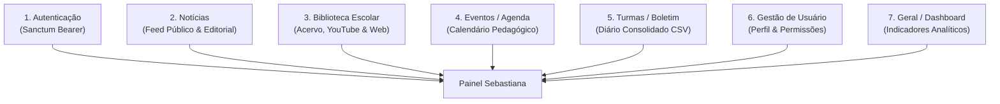

# Portal Sebastiana — EEPSAS

> **Portal Educacional e Sistema de Gestão Escolar**  
> Escola Estadual Professora Sebastiana de Almeida e Silva (EEPSAS) — Jaguaraçu-MG  
> Curso Técnico em Desenvolvimento de Sistemas (Nível Médio)

---

## 📖 Sobre o Projeto

O **Portal Sebastiana** é uma plataforma web educacional e administrativa desenvolvida sob a arquitetura de **Monorepo Desacoplado**, integrando uma API RESTful em Laravel e um Frontend SPA em React.

O projeto foi concebido com uma dupla finalidade:
1. **Atender às demandas reais da escola**: Gestão de acervo da biblioteca escolar, integração com videoaulas educativas, consulta de diários e boletins escolares, calendário letivo, notícias e controle de acessos por papéis.
2. **Ambiente Pedagógico de Excelência**: Servir como laboratório vivo para estudantes do Ensino Médio Técnico em Desenvolvimento de Sistemas, promovendo práticas reais de Engenharia de Software, desacoplamento arquitetural, blindagem de endpoints e padronização de contratos de API.

---

## 🏗️ Arquitetura do Monorepo

O repositório é organizado de forma clara e modular:

```text
portal-sebastiana/
├── portal-back/              # Backend: Laravel 12/13 API RESTful (PHP 8.5+)
│   ├── app/Http/Controllers/ # Controladores enxutos da API
│   ├── app/Http/Requests/    # Form Requests (Blindagem de Entrada)
│   ├── app/Http/Resources/   # Eloquent API Resources (Blindagem de Saída)
│   ├── app/Models/           # Modelos Eloquent e Regras de Negócio
│   ├── database/             # Migrations, Seeders e Factories
│   └── tests/                # Suíte de Testes Automatizados (Pest)
│
├── portal-front/             # Frontend: React 19 SPA Desacoplado (Vite)
│   ├── src/components/       # Componentes visuais atômicos (Bootstrap 5)
│   ├── src/context/          # Provedores de Estado Global (AuthContext)
│   ├── src/hooks/            # Custom Hooks para regras de interface
│   ├── src/pages/            # Páginas e Dashboards segmentados por Papel
│   └── src/services/         # Camada de Comunicação com API (Fetch nativo)
│
├── prompts/                  # Suíte de Prompts Pedagógicos para Estudantes
│   ├── prompt-aluno-sem-agent.md  # Para LLMs avulsos (ChatGPT, Claude, Gemini)
│   └── prompt-aluno-com-agent.md  # Para desenvolvimento assistido com Agent na IDE
│
├── apiContract.md            # Fonte Única da Verdade (Contrato 1:1 Front-Back)
└── AGENTS.md                 # Diretrizes Globais de Governança e Tutoria Técnica
```

---

## ⚡ Stack Tecnológica

| Camada | Tecnologias / Padrões Adotados | Restrições & O que NÃO usamos |
|---|---|---|
| **Backend** | **PHP 8.5+**, Laravel 12/13, Laravel Sanctum (Bearer Token), Eloquent ORM, SQLite / MySQL, Pest (testes) e Laravel Pint (PSR-12). | ❌ Sem Blade/Inertia no runtime de produção.<br/>❌ Sem retorno direto de Models brutos. |
| **Frontend** | **React 19**, Vite, React Router, Bootstrap 5 nativo e Bootstrap Icons, Fetch API nativa. | ❌ Sem Axios (Fetch nativo obrigatório).<br/>❌ Sem Tailwind CSS ou Redux. |
| **Governança** | **apiContract.md** (Contrato 1:1), Loop Delta Check (3 tentativas) e Cláusula **'PRENTYS'**. | ❌ Sem abstrações prematuras ou repositórios genéricos. |

---

## 📦 Os 7 Módulos Oficiais do Sistema



1. **Autenticação**: Emissão e controle de tokens Bearer via Laravel Sanctum, registro público de alunos e bloqueio de usuários.
2. **Notícias**: Informativos escolares públicos e gestão editorial administrativa.
3. **Biblioteca Escolar**:
   - *3.1 Acervo Físico*: Catálogo de livros didáticos e literários com controle de empréstimos.
   - *3.2 Videoaulas*: Pesquisa de conteúdos educativos consumindo a API pública do YouTube.
   - *3.3 Conteúdo Web*: Pesquisa de artigos e referências pedagógicas na web.
4. **Eventos / Agenda**: Calendário letivo escolar, feriados, recessos e datas comemorativas.
5. **Turmas / Boletim (Escopo Enxuto via CSV)**:
   - Notas e frequências são alimentadas **exclusivamente através do upload de um único arquivo CSV consolidado**.
   - O upload do arquivo é de **responsabilidade exclusiva do Especialista Pedagógico**.
   - O papel de **Professor** tem acesso estritamente **consultivo** aos diários e turmas.
   - *(Fora de escopo: cadastro manual de chamadas diárias e criação avulsa de atividades manuais)*.
6. **Gestão do Usuário (Configurações)**: Edição de perfil pessoal, alteração de senha e gestão de níveis de acesso (Adm).
7. **Geral (Painel Analítico / Dashboard)**: Métricas consolidadas, taxas de aprovação, alertas de evasão e frequência com visão segmentada por perfil.

---

## 👥 Matriz de Perfis e Permissões (`UserRole`)

| Papel (`role`) | Descrição e Nível de Acesso | Rota Inicial Pós-Login |
|---|---|---|
| `aluno` | Consulta de boletim, visualização da agenda, acervo da biblioteca e dashboard pessoal. | `/dashboard/geral` |
| `professor` | Consulta às turmas, alunos, notas e frequência (acesso estritamente consultivo). | `/dashboard/geral` |
| `bibliotecaria` | Gestão completa do acervo da biblioteca e controle de empréstimos/devoluções. | `/dashboard/biblioteca` |
| `especialista` | Importação do CSV consolidado de notas/frequência, gestão pedagógica e notícias. | `/dashboard/geral` |
| `adm` | Acesso irrestrito ao sistema, administração de papéis e simulação de perfis. | `/dashboard/geral` |

---

## 🛡️ Contrato de API e Blindagem Arquitetural

A integridade do monorepo é garantida pelo arquivo [`apiContract.md`](./apiContract.md), que funciona como a **Fonte Única da Verdade**:

- **Blindagem de Entrada**: 100% dos endpoints que recebem dados utilizam classes dedicadas de `FormRequest` em `app/Http/Requests/` (validação de tipos e proteção contra *Mass Assignment*).
- **Blindagem de Saída**: 100% das respostas JSON são formatadas por classes `JsonResource` em `app/Http/Resources/` (evita vazamento de colunas internas do banco).
- **Protocolo Loop Delta Check (3 Tentativas)**: Ao alterar models ou rotas, simulam-se requisições no trecho afetado.
- **Cláusula de Interrupção 'PRENTYS'**: Caso ocorra inconsistência após 3 checagens, o processo é pausado com o alerta:
  > ⚠️ **Atenção:** Consistência de contrato não atingida após 3 tentativas. Favor requisitar a intervenção do professor: **'PRENTYS'**.

---

## 🚀 Como Executar o Projeto Localmente

### Pré-requisitos
- **PHP 8.5 ou superior** com extensões `pdo_sqlite` (ou `pdo_mysql`), `mbstring`, `openssl`, `curl`.
- **Composer** (versão 2.7+).
- **Node.js** (versão 18+ ou 20+) e **NPM**.
- **Git**.

---

### 1. Clonando o Repositório
```bash
git clone https://github.com/seu-usuario/portal-sebastiana.git
cd portal-sebastiana
```

---

### 2. Configurando o Backend (`portal-back`)

Abra um terminal na pasta `portal-back`:

```bash
cd portal-back

# 1. Instalar as dependências PHP
composer install

# 2. Configurar o arquivo de ambiente
cp .env.example .env

# 3. Gerar a chave da aplicação
php artisan key:generate

# 4. Executar as migrações e popular o banco com dados pedagógicos
php artisan migrate --seed

# 5. Iniciar o servidor da API
php artisan serve
```

A API estará rodando em: `http://localhost:8000` (Endpoints em `http://localhost:8000/api`).

---

### 3. Configurando o Frontend (`portal-front`)

Abra um segundo terminal na pasta `portal-front`:

```bash
cd portal-front

# 1. Instalar as dependências do React
npm install

# 2. Iniciar o servidor de desenvolvimento com Vite
npm run dev
```

A aplicação React estará acessível em: `http://localhost:5173`.

---

## 🧪 Qualidade de Código e Testes Automatizados

O projeto conta com validação contínua e rigoroso padrão de qualidade:

### No Backend (`portal-back`)
```bash
# Executar a suíte de testes automatizados com Pest (100% de testes verdes)
./vendor/bin/pest

# Executar a formatação de código no padrão PSR-12 com Laravel Pint
./vendor/bin/pint
```

### No Frontend (`portal-front`)
```bash
# Executar a análise estática do ESLint
npm run lint

# Executar o build de produção com Vite
npm run build
```

---

## 🎓 Metodologia Pedagógica e Prompts dos Alunos

Para apoiar a escrita de relatórios técnicos dos estudantes e manter o alinhamento arquitetural, o monorepo conta com a pasta [`prompts/`](./prompts/):

- **[`prompt-aluno-sem-agent.md`](./prompts/prompt-aluno-sem-agent.md)**: Para alunos que utilizam IAs avulsas no navegador (ChatGPT, Claude, Gemini).
- **[`prompt-aluno-com-agent.md`](./prompts/prompt-aluno-com-agent.md)**: Guarda-corpo para alunos que programam com Agente na IDE.

### O Modelo Híbrido de Fechamento:
Ao concluir qualquer tarefa prática, a IA orienta o estudante através de:
1. **Glossário Formal de Engenharia de Software**: Tabela conectando o código aos conceitos de mercado (*Service Layer, Form Request, JsonResource, RBAC*).
2. **Roteiro Narrativo com Metáforas Didáticas**:
   - A **"Memória"** do componente (`useState`).
   - O **"Ciclo de Vida"** sem travar a tela (`useEffect`).
   - As **"Peças de Lego"** visuais (*Dumb Components* que só recebem `props`).
   - O **"Orquestrador"** de tela (Entry Point que une lógica e visual).
   - O **"Porteiro"** (`ProtectedRoute`) conferindo o **"Crachá"** (`Bearer token` e `role`).
3. **Handover no Quadro Branco / Papel**: Desenho do fluxo de dados em caixas e setas para defesa oral no laboratório de informática.

---

## 📄 Licença e Créditos

Este projeto é desenvolvido para fins exclusivamente didáticos e institucionais na **Escola Estadual Professora Sebastiana de Almeida e Silva (EEPSAS)**.

- **Coordenação Pedagógica / Professor Responsável**: Assis Prentys (`assis.prentys@gmail.com`)
- **Desenvolvimento**: Estudantes do Curso Técnico em Desenvolvimento de Sistemas