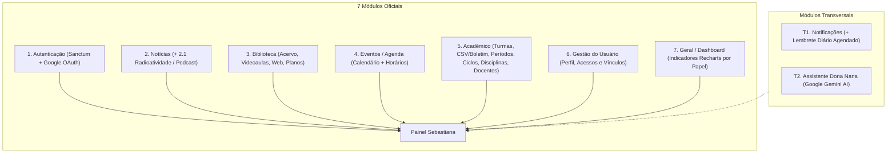

# Portal Sebastiana — EEPSAS

> **Portal Educacional e Sistema de Gestão Escolar**  
> Escola Estadual Professora Sebastiana de Almeida e Silva (EEPSAS) — Jaguaraçu-MG  
> Curso Técnico em Desenvolvimento de Sistemas (Nível Médio)

---

## 📖 Sobre o Projeto

O **Portal Sebastiana** é uma plataforma web educacional e administrativa desenvolvida sob a arquitetura de **Monorepo Desacoplado**, integrando uma API RESTful em Laravel e um Frontend SPA em React.

O projeto foi concebido com uma dupla finalidade:
1. **Atender às demandas reais da escola**: Gestão completa de matriz curricular (períodos letivos, ciclos, disciplinas e horários escolares), consulta de diários e boletins consolidados via CSV, acervo físico e digital da biblioteca escolar, calendário pedagógico, portal de notícias/podcast, mentoria virtual inteligente (**Dona Nana**) e controle de acessos por papéis.
2. **Ambiente Pedagógico de Excelência**: Servir como laboratório vivo para estudantes do Ensino Médio Técnico em Desenvolvimento de Sistemas, promovendo práticas reais de Engenharia de Software, desacoplamento arquitetural, blindagem de endpoints e padronização de contratos de API.

---

## 🏗️ Arquitetura do Monorepo

O repositório é organizado de forma clara e modular:

```text
portal-sebastiana/
├── portal-back/                  # Backend: Laravel 12/13 API RESTful (PHP 8.5+)
│   ├── app/Console/Commands/     # Comandos agendados (ex.: lembretes de notificações)
│   ├── app/Data/                 # Data Objects tipados (Spatie Laravel Data)
│   ├── app/Enums/                # Enums de domínio (UserRole, EmprestimoStatus, TipoEvento)
│   ├── app/Http/Controllers/     # Controladores enxutos da API
│   ├── app/Http/Requests/        # Form Requests (Blindagem de Entrada)
│   ├── app/Http/Resources/       # Eloquent API Resources (Blindagem de Saída)
│   ├── app/Models/               # Modelos Eloquent, RBAC e relacionamentos
│   ├── app/Notifications/        # Notificações internas do portal
│   ├── app/Policies/             # Políticas de autorização por recurso
│   ├── app/Services/             # Regras de negócio, estatísticas e integrações (Gemini, Horários)
│   ├── database/                 # Migrations, Seeders e Factories
│   ├── tests/                    # Suíte de Testes Automatizados (Pest)
│   ├── _archive/fora_de_escopo/  # Estruturas antigas arquivadas com segurança
│   └── .github/workflows/        # Pipeline de Integração Contínua (GitHub Actions)
│
├── portal-front/                 # Frontend: React 19 SPA Desacoplado (Vite 8)
│   ├── src/components/           # Componentes visuais modulares (Bootstrap 5, Recharts, dnd-kit)
│   ├── src/contexts/             # Contextos globais da aplicação (authContext)
│   ├── src/hooks/                # Custom Hooks organizados por domínio
│   ├── src/layouts/              # Layouts aninhados (PortalLayout e DashboardLayout)
│   ├── src/pages/                # Páginas públicas e Dashboards segmentados por Papel
│   ├── src/services/             # Camada de Comunicação HTTP (api.js + serviços de domínio)
│   └── src/utils/                # Navegação declarativa (dashboardNav), RBAC e Schemas Zod
│
├── prompts/                      # Suíte de Prompts Pedagógicos para Estudantes
│   ├── prompt-aluno-sem-agent.md # Para LLMs avulsos (ChatGPT, Claude, Gemini)
│   └── prompt-aluno-com-agent.md # Para desenvolvimento assistido com Agent na IDE
│
├── docs/                         # Registros históricos e memória arquitetural
├── apiContract.md                # Fonte Única da Verdade (Contrato 1:1 Front-Back)
└── AGENTS.md                     # Diretrizes Globais de Governança e Tutoria Técnica
```

---

## ⚡ Stack Tecnológica

| Camada | Tecnologias / Padrões Adotados | Restrições & Observações |
|---|---|---|
| **Backend** | **PHP 8.5+**, Laravel 12/13, Laravel Sanctum (Bearer Token), Eloquent ORM, **Spatie Laravel Data**, integração REST com **Google Gemini**, SQLite / MySQL, Larastan/PHPStan, Pest e Laravel Pint (PSR-12). | ❌ Sem Blade/Inertia/Wayfinder no runtime de produção *(pacotes presentes apenas como resíduo inativo do starter kit)*.<br/>❌ Sem retorno direto de Models brutos. |
| **Frontend** | **React 19**, Vite 8, React Router 7, Bootstrap 5 nativo e Bootstrap Icons, **Recharts** (gráficos), **Zod** (schemas em runtime), **@dnd-kit** (*drag & drop*), Fetch API nativa. | ❌ Sem Axios (Fetch nativo obrigatório).<br/>❌ Sem Tailwind CSS, Redux ou TypeScript no front. |
| **Governança** | **[`apiContract.md`](./apiContract.md)** (Contrato 1:1), Data Objects + Schemas Zod espelhados, Loop Delta Check (3 tentativas) e Cláusula **'PRENTYS'**. | ❌ Sem Repositories genéricos ou abstrações sem uso real. |

---

## 📦 Os 7 Módulos Oficiais e Módulos Transversais



### Módulos Oficiais
1. **Autenticação**: Emissão e controle de tokens Bearer via Laravel Sanctum, login social via Google OAuth 2.0 (`Login With Google`), registro público de alunos e tela de espera para confirmação de vínculo docente.
2. **Notícias**: Informativos escolares públicos e gestão editorial administrativa.
   - *2.1 Radioatividade / Podcast*: Episódios e conteúdos da rádio escolar exibidos no portal público.
3. **Biblioteca Escolar**:
   - *3.1 Acervo de Livros*: Catálogo físico escolar, autopreenchimento de metadados via **Google Books API**, importação em massa por CSV e controle de empréstimos.
   - *3.2 Videoaulas*: Pesquisa e reprodução de conteúdos educativos consumindo a **YouTube Data API v3**.
   - *3.3 Conteúdo Web*: Pesquisa de artigos e referências didáticas pelo widget oficial do **Google Programmable Search Engine** (`cx`, sem necessidade de chave de API).
   - *3.4 Planos de Estudos*: Trilhas de aprendizagem personalizadas reunindo livros, vídeos e links web, com compartilhamento para turmas.
4. **Eventos / Agenda**:
   - *4.1 Calendário Escolar*: Visão pública *read-only* de eventos institucionais/feriados e agenda autenticada somando os eventos pessoais de cada usuário (com suporte a cadastro em massa).
   - *4.2 Horários Escolares*: Geração automática da grade semanal por turma e ajuste interativo de aulas via *drag & drop* (`@dnd-kit`).
5. **Acadêmico (Turmas, Boletim e Matriz Curricular)**:
   - *5.1 Turmas e Matrículas*: Cadastro de turmas, vínculo de disciplinas e enturmação/transferência de alunos.
   - *5.2 Importação CSV e Boletim (Escopo Enxuto)*:
     - Notas e frequências são alimentadas **exclusivamente através do upload de arquivo CSV consolidado** (com suporte multi-período e emissão de boletim).
     - O upload do arquivo é de **responsabilidade exclusiva do Especialista Pedagógico** (e Adm).
     - O papel de **Professor** tem acesso estritamente **consultivo** aos diários e turmas.
     - *(Fora de escopo: cadastro manual de chamadas diárias e criação avulsa de atividades manuais)*.
   - *5.3 Período Letivo*: Configuração de bimestres/trimestres/semestres, distribuição de pontos e sincronização automática de marcos com a Agenda.
   - *5.4 Ciclos e Turnos*: Estruturação dos ciclos curriculares e turnos da escola.
   - *5.5 Disciplinas*: Catálogo curricular por ciclos, carga horária anual e habilidades da BNCC.
   - *5.6 Professores*: Fluxo de confirmação/recusa de pertencimento docente e alocação em disciplinas.
6. **Gestão do Usuário (Configurações e Acessos)**: Edição de perfil pessoal, foto (avatar), alteração de senha, aprovação de vínculos pendentes e administração completa de usuários e papéis (Adm).
7. **Geral (Painel Analítico / Dashboard)**: Métricas consolidadas, taxas de aprovação, alertas de risco/evasão e circulação da biblioteca renderizados com **Recharts** de acordo com o papel ativo.

### Módulos Transversais
- **T1. Notificações**: Central de alertas internos e comunicados super-importantes no cabeçalho do painel, acompanhada do agendamento diário `app:enviar-lembretes-notificacoes`.
- **T2. Assistente Dona Nana**: Mentora virtual inspirada na patrona da escola, integrada ao **Google Gemini** via HTTP REST nativo, disponível em página própria e widget flutuante, com painel administrativo de configuração de persona/System Prompt e *fallback* amigável caso a chave de API não esteja configurada.

---

## 👥 Matriz de Perfis e Permissões (`UserRole`)

| Papel (`role`) | Descrição e Nível de Acesso | Rota Inicial Pós-Login |
|---|---|---|
| `aluno` | Painel Geral do Aluno, Boletim, Agenda (Calendário + Horários), Disciplinas, Biblioteca (com Planos), Dona Nana e Configurações. | `/dashboard/geral` |
| `professor` | Painel Geral do Professor, consulta às suas turmas/alunos, Disciplinas, Agenda, Biblioteca, Dona Nana e Configurações (acesso consultivo ao diário). | `/dashboard/geral` |
| `bibliotecaria` | Painel Geral da Bibliotecária, gestão completa do acervo e empréstimos/devoluções, Agenda, Dona Nana e Configurações. | `/dashboard/geral` |
| `especialista` | Painel Geral do Especialista, gestão acadêmica completa (Turmas + upload CSV, Período Letivo, Ciclos, Disciplinas, Professores), Notícias, Agenda, Biblioteca e configuração da Dona Nana. | `/dashboard/geral` |
| `adm` | Acesso irrestrito a todos os módulos, Gestão de Usuários (`/dashboard/usuarios`) e simulação de perfis no cabeçalho. | `/dashboard/geral` |

> *Nota de Compatibilidade:* O enum `UserRole` preserva o caso legado `padrao` para compatibilidade com registros antigos (tratado no sistema com o mesmo acesso de `aluno` e indisponível para novos cadastros). Todo auto-cadastro em `/api/auth/register` recebe o papel `aluno`.

---

## 🛡️ Contrato de API e Blindagem Arquitetural

A integridade do monorepo é garantida pelo arquivo [`apiContract.md`](./apiContract.md), que funciona como a **Fonte Única da Verdade**:

- **Blindagem de Entrada**: 100% dos endpoints que recebem dados utilizam classes dedicadas de `FormRequest` em `app/Http/Requests/` (apoiadas por Data Objects tipados com **Spatie Laravel Data** em `app/Data/`).
- **Blindagem de Saída**: 100% das respostas JSON com dados são formatadas por classes `JsonResource` em `app/Http/Resources/` (evitando vazamento de colunas internas do banco), além de revalidação estrita em runtime com **Zod** no frontend (`academicoSchemas.js`).
- **Protocolo Loop Delta Check (3 Tentativas)**: Ao alterar models, Data Objects ou rotas, simulam-se requisições no trecho afetado para atestar correspondência 1:1.
- **Cláusula de Interrupção 'PRENTYS'**: Caso ocorra inconsistência após 3 checagens, o processo é pausado com o alerta:
  > ⚠️ **Atenção:** Consistência de contrato não atingida após 3 tentativas. Favor requisitar a intervenção do professor: **'PRENTYS'**.

---

## 🚀 Como Executar o Projeto Localmente

### Pré-requisitos
- **PHP 8.5 ou superior** com extensões `curl`, `openssl`, `mbstring`, `fileinfo` e `pdo_sqlite` (ou `pdo_mysql`).
- **Composer** (versão 2.7+).
- **Node.js 22 ou superior** (exigido pelo Vite 8 e alinhado à pipeline CI) e **NPM**.
- **Git**.

---

### 0. Configuração SSL no Windows (`cacert.pem`)
No Windows, para que a validação OAuth do **Login With Google** e as chamadas REST ao **Google Gemini** (Dona Nana) funcionem sem o erro `cURL error 60`, baixe o pacote oficial de certificados raiz da Mozilla (`https://curl.se/ca/cacert.pem`), salve em `C:\php\extras\ssl\cacert.pem` e habilite no seu `php.ini` ativo (`php --ini`):

```ini
curl.cainfo = "C:\php\extras\ssl\cacert.pem"
openssl.cafile = "C:\php\extras\ssl\cacert.pem"
```

---

### 1. Clonando o Repositório
```bash
git clone https://github.com/EEPSAS/portal-sebastiana.git
cd portal-sebastiana
```

---

### 2. Configurando o Backend (`portal-back`)

Abra um terminal na pasta `portal-back`:

```bash
cd portal-back

# 1. Instalar as dependências PHP
composer install

# 2. Configurar o arquivo de ambiente (garanta que database/database.sqlite exista ao usar SQLite)
cp .env.example .env

# 3. Gerar a chave da aplicação
php artisan key:generate

# 4. Executar as migrações e popular o banco com dados pedagógicos iniciais
php artisan migrate --seed

# 5. Criar o link simbólico de armazenamento público (avatares e capas)
php artisan storage:link

# 6. Iniciar o servidor da API
php artisan serve
```

A API estará rodando em: `http://localhost:8000` (Endpoints em `http://localhost:8000/api`).

> **Dicas úteis no Backend:**
> - O comando `php artisan schedule:work` pode ser executado em paralelo caso deseje testar localmente o disparo agendado de lembretes de notificações.
> - Os atalhos `composer setup` e `composer dev` existem no `portal-back/composer.json` (usados pela CI), mas atenção: por herança do starter kit, eles também instalam/rodam os assets Node internos do `portal-back` — para o desenvolvimento diário da SPA oficial, inicie o frontend em `portal-front` conforme o passo 3.

---

### 3. Configurando o Frontend (`portal-front`)

Abra um segundo terminal na pasta `portal-front`:

```bash
cd portal-front

# 1. Criar o arquivo de variáveis de ambiente locais
cp .env.example .env

# 2. Instalar as dependências do React
npm install

# 3. Iniciar o servidor de desenvolvimento com Vite (porta fixa 5173)
npm run dev
```

A aplicação React estará acessível em: `http://localhost:5173`.

---

## 🔐 Variáveis de Ambiente (`.env`)

Nunca versione arquivos `.env` reais. Utilize os arquivos `.env.example` de cada camada como referência:

### Backend (`portal-back/.env`)
| Variável | Finalidade |
|---|---|
| `FRONTEND_URL` | Origem autorizada da SPA React para CORS e Sanctum (local: `http://localhost:5173`). |
| `SANCTUM_STATEFUL_DOMAINS` | Domínios stateful reconhecidos pelo Laravel Sanctum. |
| `GOOGLE_CLIENT_ID` | Client ID OAuth 2.0 Web do Google Cloud Console *(deve ser idêntico ao `VITE_GOOGLE_CLIENT_ID`)*. |
| `GOOGLE_CLIENT_SECRET` | Chave secreta OAuth 2.0 do projeto Google Cloud. |
| `GOOGLE_REDIRECT_URI` | URI de redirecionamento OAuth configurada no provedor. |
| `GOOGLE_PROJECT_ID` | Identificador do projeto no Google Cloud Console. |
| `GEMINI_API_KEY` | Chave da API Google Gemini para a assistente **Dona Nana** *(se vazia em dev, ativa fallback amigável)*. |
| `GEMINI_MODEL` | Modelo generativo utilizado pela Dona Nana (ex.: `gemini-3.8-flash`). |

### Frontend (`portal-front/.env`)
| Variável | Finalidade |
|---|---|
| `PORT` | Porta fixa do servidor Vite local (padrão `5173`, exigida para coincidir com o CORS e o Google OAuth). |
| `VITE_API_URL` | URL base da API Laravel sem barra final (local: `http://localhost:8000/api`). |
| `VITE_GOOGLE_CLIENT_ID` | Client ID OAuth 2.0 para o botão *Login With Google* (`Google Identity Services`). |
| `VITE_YOUTUBE_API_KEY` | Chave com **YouTube Data API v3** ativada (aba *3.2 Videoaulas* da Biblioteca). |
| `VITE_GOOGLE_BOOKS_API_KEY` | Chave com **Books API** ativada (autopreenchimento de livros na aba *3.1 Acervo*). |

> *Nota:* A aba *3.3 Conteúdo Web* utiliza o widget oficial do **Google Programmable Search Engine** (`cx`) e não requer chave de API no `.env`.

---

## 🧪 Qualidade de Código e Testes Automatizados

O projeto conta com validação contínua e rigoroso padrão de qualidade:

### No Backend (`portal-back`)
```bash
# Executar a suíte de testes automatizados com Pest
php artisan test --compact
# (ou diretamente: ./vendor/bin/pest)

# Formatar arquivos alterados no padrão PSR-12 com Laravel Pint
./vendor/bin/pint --dirty

# Executar a análise estática de tipos com Larastan / PHPStan
composer types:check
```

### No Frontend (`portal-front`)
```bash
# Executar a análise estática do ESLint
npm run lint

# Executar o build de produção com Vite
npm run build
```

---

## ☁️ Deploy (Railway) e Integração Contínua (CI)

### Deploy Desacoplado no Railway
Cada camada possui seu próprio manifesto `railway.json`:
- **`portal-back/railway.json`**: executa `composer install --no-dev --optimize-autoloader --no-interaction` no build e inicia com `php artisan storage:link --force && php artisan migrate --force && php artisan serve --host=0.0.0.0 --port=${PORT:-8000}`, monitorado via healthcheck em `/up`.
- **`portal-front/railway.json`**: compila a SPA via `npm run build` e serve a distribuição com `npx vite preview --host 0.0.0.0 --port ${PORT:-4173}` (mantendo o header `Cross-Origin-Opener-Policy: same-origin-allow-popups`).
- As variáveis de produção referenciam os domínios internos do Railway (`FRONTEND_URL=https://${{portal-front.RAILWAY_PUBLIC_DOMAIN}}` no back e `VITE_API_URL=https://${{portal-back.RAILWAY_PUBLIC_DOMAIN}}/api` no front).

### GitHub Actions (`CI`)
O workflow [`portal-back/.github/workflows/tests.yml`](./portal-back/.github/workflows/tests.yml) é disparado em *pushes* para `main` e em *Pull Requests*, provisionando **PHP 8.5** e **Node.js 22** em `ubuntu-latest` para validar setup, lint, tipagem estática e a suíte completa de testes (`composer setup` → `composer ci:check`).

---

## 🎓 Metodologia Pedagógica e Prompts dos Alunos

Para apoiar a escrita de relatórios técnicos dos estudantes e manter o alinhamento arquitetural, o monorepo conta com a pasta [`prompts/`](./prompts/):

- **[`prompt-aluno-sem-agent.md`](./prompts/prompt-aluno-sem-agent.md)**: Para alunos que utilizam IAs avulsas no navegador (ChatGPT, Claude, Gemini).
- **[`prompt-aluno-com-agent.md`](./prompts/prompt-aluno-com-agent.md)**: Guarda-corpo para alunos que programam com Agente na IDE.

### O Modelo Híbrido de Fechamento:
Ao concluir qualquer tarefa prática, a IA orienta o estudante através de:
1. **Glossário Formal de Engenharia de Software**: Tabela conectando o código aos conceitos de mercado (*Service Layer, Form Request, JsonResource, RBAC*).
2. **Roteiro Narrativo com Metáforas Didáticas**:
   - A **"Memória"** do componente (`useState`).
   - O **"Ciclo de Vida"** sem travar a tela (`useEffect`).
   - As **"Peças de Lego"** visuais (*Dumb Components* que só recebem `props`).
   - O **"Orquestrador"** de tela (Entry Point que une lógica e visual).
   - O **"Porteiro"** (`ProtectedRoute`) conferindo o **"Crachá"** (`Bearer token` e `role`).
3. **Handover no Quadro Branco / Papel**: Desenho do fluxo de dados em caixas e setas para defesa oral no laboratório de informática.

---

## 📄 Licença e Créditos

Este projeto é desenvolvido para fins exclusivamente didáticos e institucionais na **Escola Estadual Professora Sebastiana de Almeida e Silva (EEPSAS)**.

- **Coordenação Pedagógica / Professor Responsável**: Assis Prentys (`assis.prentys@gmail.com`)
- **Desenvolvimento**: Estudantes do Curso Técnico em Desenvolvimento de Sistemas