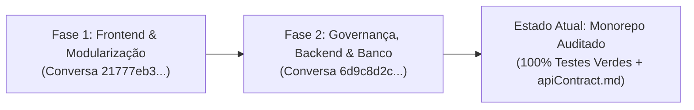
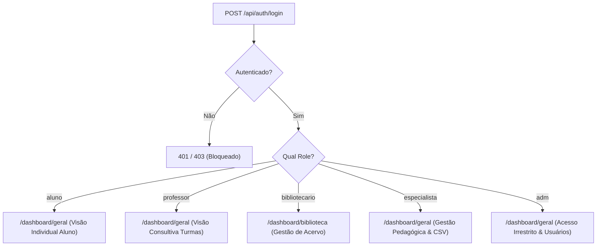

# Revisão Sistemática da Arquitetura — Portal Sebastiana (EEPSAS)

Este documento registra a consolidação técnica e a memória de cálculo da refatoração do **Portal Sebastiana**, monorepo web da Escola Estadual Professora Sebastiana de Almeida e Silva (EEPSAS), situada em Jaguaraçu-MG.

---

## 1. Contexto e Histórico da Refatoração

O projeto passou por duas grandes fases de auditoria e saneamento técnico:

### Fase 1: Modularização e Desacoplamento do Frontend
* **Desmonte do Padrão Smart/Dumb**: Eliminação de pastas aninhadas e nomenclaturas redundantes em favor de componentes funcionais declarativos.
* **Menu Lateral Dinâmico (`Aside.jsx`)**: Unificação de dois menus laterais legados em um único componente parametrizado pela matriz de papéis (`roles`).
* **Proteção Declarativa de Rotas**: `ProtectedRoute.jsx` com suporte à propriedade `allowedRoles` e redirecionamento de landing page condicional (`/dashboard/biblioteca` para Bibliotecário e `/dashboard/geral` para os demais).
* **Modularização da Biblioteca Escolar**: O arquivo monolítico `BibliotecaPadrao.jsx` (860 linhas) foi dividido em orquestrador, componentes atômicos de abas e modais, e dois custom hooks especializados (`useBiblioteca` e `useYouTubeVideoaulas`).
* **Qualidade Visual e Linter**: 100% dos 7 erros de ESLint foram sanados e estilos inline foram organizados em `PascalCase.css` com Bootstrap 5.

### Fase 2: Governança dos AGENTS, Contrato 1:1 e Blindagem da API
* **Unificação e Governança**: Harmonização das diretrizes em `AGENTS.md` (raiz), `portal-back/AGENTS.md` e `portal-front/AGENTS.md`, com adoção mandatória de **PHP 8.5+** e **React 19**.
* **Purga de Over-Engineering**: Expurgo completo de resíduos de starter kits não utilizados no backend (Inertia, Tailwind, Wayfinder e Laravel Cloud), preservando uma API REST pura.
* **Criação da Fonte Única da Verdade (`apiContract.md`)**: Mapeamento 1:1 rigoroso de rotas, DTOs de entrada e saídas JSON, acompanhado do **Protocolo do Loop Delta Check (3 tentativas)** e da **Cláusula de Interrupção 'PRENTYS'**.
* **Blindagem Total da API**:
  - *Entrada*: 100% validada via classes `FormRequest` em `app/Http/Requests/`.
  - *Saída*: 100% encapsulada em classes `JsonResource` em `app/Http/Resources/` (12 novos Resources criados, zero vazamento de models brutos).
* **Escopo Enxuto de Notas e Frequências**: Eliminação de fluxos manuais dispersos; notas e faltas são populadas **exclusivamente via upload de CSV consolidado pelo Especialista**. O Professor atua em papel puramente consultivo.
* **Saneamento de Banco de Dados**: Migrations, factories e rotas de módulos fora de escopo (Atividades, Submissões e Remessas) foram isoladas com segurança em `_archive/fora_de_escopo/`, e a chave estrangeira órfã `remessa_origem_id` foi expurgada do banco.
* **Garantia de Qualidade (DoD)**: **66 testes Pest aprovados com 100% de sucesso (521 asserções)**, Laravel Pint código 0, ESLint código 0 e build Vite em menos de 400ms.

---

## 2. A Matriz dos 7 Módulos Oficiais

| Módulo | Escopo Funcional | Papéis com Acesso Principal | Endpoints Chave |
|---|---|---|---|
| **1. Autenticação** | Login Sanctum, emissão de Bearer token, registro de alunos e bloqueio de contas. | Todos (público para registro de aluno) | `POST /api/auth/login` `POST /api/auth/register` |
| **2. Notícias** | Feed público e painel administrativo editorial. | Todos (leitura); Especialista/Adm (gestão) | `GET /api/noticias` `POST /api/noticias` |
| **3. Biblioteca Escolar** | 3.1 Acervo físico e empréstimos. 3.2 Videoaulas (YouTube Data API). 3.3 Conteúdo Web (Google Search API). | Todos (pesquisa); Bibliotecária (gestão total de acervo/empréstimos) | `GET /api/livros` `POST /api/emprestimos/solicitar` `PATCH /api/emprestimos/{id}/aprovar` |
| **4. Eventos / Agenda** | Calendário letivo, feriados e datas comemorativas. | Todos | `GET /api/eventos` `POST /api/eventos` |
| **5. Turmas / Boletim (CSV)** | Notas e frequências consolidadas geradas exclusivamente por upload de diário CSV. | Especialista (importação); Professor (consulta); Aluno (boletim) | `POST /api/turmas/{id}/importar-relatorio` `GET /api/alunos/{id}/turmas/{id}/boletim` |
| **6. Gestão do Usuário** | Perfil pessoal, configurações e administração de acessos/bloqueios. | Todos (perfil próprio); Administrador (bloquear/alterar papéis) | `PATCH /api/usuarios/{id}/bloquear` `PATCH /api/usuarios/{id}/papel` |
| **7. Geral (Painel Analítico)** | Dashboard com cruzamento estatístico, KPIs e gráficos (radar, pizza, alertas de risco). | Todos (com visão segmentada por role) | `GET /api/turmas/{id}/resumo-gerencial` `GET /api/alunos/{id}/turmas/{id}/resumo-global` |

---

## 3. Matriz de Perfis (`App\Enums\UserRole`)

---

## 4. O Protocolo da Cláusula 'PRENTYS'

Para manter a integridade inegociável entre o que o frontend chama e o que o backend entrega:
1. Ao criar ou modificar campos em Models ou Services, o desenvolvedor ou agente deve inspecionar o [`apiContract.md`](file:///c:/Users/prent/OneDrive/Documentos/repositorios/portal-sebastiana/apiContract.md).
2. É disparado o **Loop Delta Check**: simulação de até 3 requisições HTTP locais no trecho afetado.
3. Se houver divergência após a 3ª tentativa, a regra de contingência é acionada:
   > ⚠️ **Atenção:** Consistência de contrato não atingida após 3 tentativas. Favor requisitar a intervenção do professor: **'PRENTYS'**.

---

## 5. Diretrizes Pedagógicas e o Modelo Híbrido de Relatório Técnico

Para garantir que os estudantes do ensino técnico compreendam a arquitetura e articulem o vocabulário de mercado sem se perderem em formalismos excessivos, os prompts base em `prompts/` adotam a **Estrutura Híbrida de Fechamento**:

1. **A Engrenagem por Trás do Código**: Explicação em 2 a 3 frases conectando a funcionalidade ao todo.
2. **Glossário Orientativo (Tabela de Mapeamento)**: Tabela de 3 colunas (*O que você fez na prática* | *Termo Técnico de Mercado* | *Como citar no relatório técnico*).
3. **O Roteiro Narrativo com Metáforas Didáticas**: Orientações em prosa para o aluno redigir o relatório, conectando metáforas intuitivas aos conceitos de Engenharia de Software:
   - **Camada de Serviço (Service Layer)**: Desacoplar regra de comunicação de dados da regra visual via `Fetch` nativo (evitar *"fiz a conexão com a API"*).
   - **Gerenciamento de Estado**: `useState` como a **"memória"** do componente para dados da API.
   - **Ciclo de Vida e Efeitos Colaterais**: `useEffect` para animações e transições assíncronas pós-montagem sem travar a interface (evitar *"fiz as barras subirem"*).
   - **Arquitetura de Interface**: Componentes de Apresentação (*Dumb Components*) como **"peças de Lego"** que só recebem dados via `props` (Princípio da Responsabilidade Única - SRP); Entry Point como o **"orquestrador"** que invoca lógica e distribui dados.
   - **Controle de Acesso (RBAC)**: `ProtectedRoute` como o **"porteiro"** que confere o **"crachá"** (`Bearer token` e `role`) e barra acessos indevidos redirecionando o aluno.
4. **Handover no Quadro Branco / Papel**: Fixação ativa onde o aluno desenha o diagrama de caixas e setas narrando o caminho dos dados e do controle de acesso para um colega ou para o professor.
